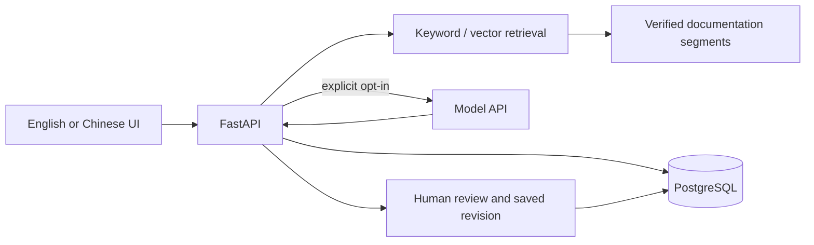

# Architecture

1. **Sources and segmentation.** `app/baseline.py` checks the source metadata and hashes, converts fixed MDX files into traceable text segments, and preserves code blocks. `app/evidence_context.py` attaches bounded context from the same source section.
2. **Retrieval.** Keyword search uses weighted lexical overlap with a small bilingual vocabulary. An optional pgvector index stores real embeddings; hybrid mode merges keyword and vector rankings. A targeted fixed-corpus rule supplies the secret-key user-token exception when a broad summary would otherwise miss it.
3. **Generation.** `app/workflow.py` reconstructs verified segments from the fixed source files and checks the saved citation and database segment against them. It rebuilds context from those source files before preparing model input. `app/model_gateway.py` supports a local OpenAI configuration and a Gemini adapter, with paid calls disabled by default. Citation IDs are validated against the retrieved candidates.
4. **Review and persistence.** `app/api.py` exposes the local API and applies an origin check to all browser write requests. `app/database.py` stores tickets and runs; reviews are appended separately so an edited draft does not overwrite the model output. The frontend separates structure (`app/stage1.html`), appearance (`app/stage1.css`), and interaction (`app/stage1.js`).

The response check for the secret-key qualification uses citation and keyword checks. It is a narrow guard, not semantic verification. All generated content still requires a human reviewer.

This is a local, single-user demo. Origin checking is defense in depth for browser requests, not authentication, tenant isolation, or authorization for public deployment. The frontend JavaScript still combines translations, rendering, and API calls; if the interface grows, these can be split further along those responsibilities.
